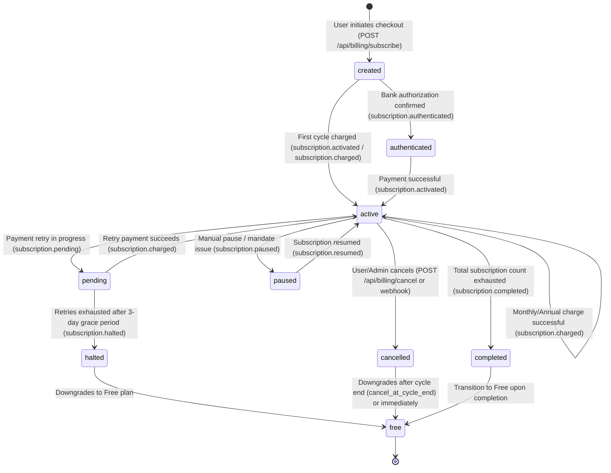

# Razorpay Subscription Lifecycle & Webhook Architecture

This document defines the lifecycle states, state transitions, security guarantees, and local development testing workflows for ExportLeak's Razorpay recurring subscription engine.

---

## 1. Subscription State Transition Diagram



---

## 2. Event Handling & State Mapping

| Razorpay Event               | Database `subscriptions.status` | Database `organizations.plan_status`           | Plan Action                                                                                            |
| ---------------------------- | ------------------------------- | ---------------------------------------------- | ------------------------------------------------------------------------------------------------------ |
| `subscription.authenticated` | `authenticated`                 | Preserved / unchanged                          | Mandate confirmed; awaits initial charge.                                                              |
| `subscription.activated`     | `active`                        | `active`                                       | Unlocks paid plan entitlements immediately; ends trial; sends receipt.                                 |
| `subscription.charged`       | `active`                        | `active`                                       | Records renewed cycle (`current_start`, `current_end`); sends receipt.                                 |
| `subscription.pending`       | `pending`                       | `past_due`                                     | Starts **3-day grace period** (`BILLING_GRACE_PERIOD_DAYS = 3`). Features stay active.                 |
| `subscription.halted`        | `halted`                        | `halted`                                       | Retries exhausted. Downgrades org to `free`. Existing data remains permanently readable.               |
| `subscription.cancelled`     | `cancelled`                     | `active` until `current_end`, then `cancelled` | If `cancel_at_cycle_end` is true, user keeps access until cycle end. Otherwise downgraded immediately. |
| `subscription.paused`        | `paused`                        | `paused`                                       | Pauses renewal charges.                                                                                |
| `subscription.resumed`       | `active`                        | `active`                                       | Resumes active status.                                                                                 |
| `subscription.completed`     | `completed`                     | `completed`                                    | All 120 monthly / 10 annual cycles completed.                                                          |
| `payment.failed`             | Unchanged                       | Unchanged                                      | Triggers owner notification email with direct link to update payment method.                           |
| `refund.processed`           | Unchanged                       | `refunded` / `free`                            | Reverts organization to `free` tier if latest cycle charge is refunded.                                |

---

## 3. Idempotency & Security Guarantees

1. **HMAC-SHA256 Signature Verification**:
   - The raw incoming body is verified against `RAZORPAY_WEBHOOK_SECRET` using `crypto.timingSafeEqual` before JSON parsing. Fails closed (HTTP 400).
2. **Unique Event Idempotency**:
   - Every event ID is recorded in `public.payment_events` with a `UNIQUE` constraint. Duplicate deliveries return HTTP 200 immediately without reprocessing side effects.
3. **Out-of-Order Safety**:
   - Status transitions obey strict monotonic ranking: an older delayed event (such as `subscription.authenticated`) cannot downgrade an already `active` subscription.
4. **Hard Rule #10 Isolation**:
   - The browser payment callback (`/api/billing/verify`) NEVER activates a subscription or updates plan status. Only the verified webhook from Razorpay triggers activation.

---

## 4. Local Testing & Tunnel Setup

To test webhooks locally in development:

### Step 1: Start a Local Tunnel

Run an HTTPS tunnel pointing to your local Next.js dev server on port 3000:

```bash
# Using ngrok
ngrok http 3000

# Or using cloudflared
cloudflared tunnel --url http://localhost:3000
```

### Step 2: Configure Razorpay Dashboard

1. Log in to [Razorpay Dashboard](https://dashboard.razorpay.com/) in **Test Mode**.
2. Navigate to **Settings** -> **Webhooks**.
3. Click **Add New Webhook**.
4. Set Webhook URL: `https://<your-tunnel-domain>/api/webhooks/razorpay`.
5. Enter a secure Webhook Secret (e.g. `test_webhook_secret_67890`) and set it as `RAZORPAY_WEBHOOK_SECRET` in your `.env.local`.
6. Select the events:
   - `subscription.authenticated`
   - `subscription.activated`
   - `subscription.charged`
   - `subscription.pending`
   - `subscription.halted`
   - `subscription.cancelled`
   - `subscription.paused`
   - `subscription.resumed`
   - `payment.failed`
   - `refund.processed`

### Step 3: Run the CLI Webhook Test Script

Run our local signed test script against your server:

```bash
node scripts/test-razorpay-webhook.mjs
```
